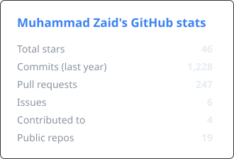
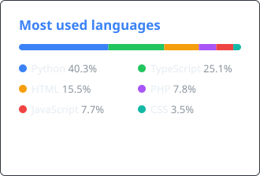

<h1 align="center">Muhammad Zaid</h1>
<p align="center"><b>AI Data Engineer</b> · Python · Peshawar, Pakistan</p>

<p align="center">
  <a href="https://misterzaid.com">
    
  </a>
</p>

<p align="center">
  <a href="https://misterzaid.com"></a>
  <a href="https://linkedin.com/in/misterzaidxpy"></a>
  <a href="https://www.upwork.com/freelancers/~01aaf487e29d60a885"></a>
  <a href="mailto:contact@misterzaid.com"></a>
</p>

---

### What I build

Most AI projects stall on data, not models. I build the Python systems that get that data out of the web, clean it, and hand it to the model.

```python
>>> from misterzaid import Zaid
>>> Zaid.hello()
```
```text
 Hi, I'm Zaid. I turn the messy web into data AI can use.
```

```text
  the web                   my pipelines                        your AI
 ─────────          ───────────────────────────           ─────────────────
  sites, APIs  ──▶   extract  ──▶  clean  ──▶  structure  ──▶   LLM apps, RAG
  PDFs, video        (anti-bot     (dedupe,    (schemas,        agents (MCP)
  protected pages     resilient)    validate)   JSON, SQL)      fine-tuning data
```

- **30+** data systems running in production, **15+** open-source data tools
- **Top Rated** on Upwork with **100%** Job Success
- Offensive security background: I design for failure and abuse from day one
- Learning in public: fine-tuning and evaluating open models on data I collect myself

---

### Core stack

<p align="center">
  
</p>

| Area | Tools |
|---|---|
| AI & LLM | OpenAI and Anthropic APIs, MCP SDK, structured extraction, OCR |
| Web data | Playwright, Scrapy, curl_cffi, internal API reverse engineering |
| Pipelines | Celery, task queues, PostgreSQL, Redis, scheduling, webhooks |
| Shipping | FastAPI, Docker, GitHub Actions, Linux |

---

### Open-source data tools

<table>
  <tr>
    <td width="50%" valign="top">
      <h3><a href="https://github.com/misterzaidxpy/tubescrape">tubescrape</a></h3>
      <a href="https://github.com/misterzaidxpy/tubescrape">
        
      </a>
      <a href="https://pypi.org/project/tubescrape/">
        
      </a>
      <br><br>
      YouTube search, channels, playlists and transcripts with no API key. SDK, CLI and REST API. Powers a YouTube data tool on the Apify Store.
    </td>
    <td width="50%" valign="top">
      <h3><a href="https://github.com/misterzaidxpy/linkedinscrape">linkedinscrape</a></h3>
      <a href="https://github.com/misterzaidxpy/linkedinscrape">
        
      </a>
      <br><br>
      Turns LinkedIn profiles into structured data (experience, education, skills) for profile analysis.
    </td>
  </tr>
  <tr>
    <td width="50%" valign="top">
      <h3><a href="https://github.com/misterzaidxpy/shopscout">shopscout</a></h3>
      <a href="https://github.com/misterzaidxpy/shopscout">
        
      </a>
      <a href="https://pypi.org/project/shopscout/">
        
      </a>
      <br><br>
      Products, collections and pages from any Shopify store, from the public JSON API.
    </td>
    <td width="50%" valign="top">
      <h3><a href="https://github.com/misterzaidxpy/reddipy">reddipy</a></h3>
      <a href="https://github.com/misterzaidxpy/reddipy">
        
      </a>
      <a href="https://pypi.org/project/reddipy/">
        
      </a>
      <br><br>
      Reddit posts, comment trees and user activity as structured data, with an SDK and CLI.
    </td>
  </tr>
  <tr>
    <td width="50%" valign="top">
      <h3><a href="https://github.com/misterzaidxpy/wpscrape">wpscrape</a></h3>
      <a href="https://github.com/misterzaidxpy/wpscrape">
        
      </a>
      <a href="https://pypi.org/project/wpscrape/">
        
      </a>
      <br><br>
      Products and categories from any WordPress or WooCommerce store via the public REST API.
    </td>
    <td width="50%" valign="top">
      <h3><a href="https://github.com/misterzaidxpy/flipkart-scraper">flipkart-scraper</a></h3>
      <a href="https://github.com/misterzaidxpy/flipkart-scraper">
        
      </a>
      <br><br>
      Full-stack product data tool: FastAPI backend, Next.js frontend, search, filtering and MySQL storage.
    </td>
  </tr>
</table>

---

### GitHub trophies

<p align="center">
  
</p>

---

### GitHub stats

<p align="center">
  
  
</p>

<p align="center">
  
</p>

---

<p align="center">
  Need web data for an AI product, or an LLM tool that works on real-world data?<br>
  <a href="mailto:contact@misterzaid.com"><b>contact@misterzaid.com</b></a> · <a href="https://misterzaid.com/blog/">Read my writing</a>
</p>
